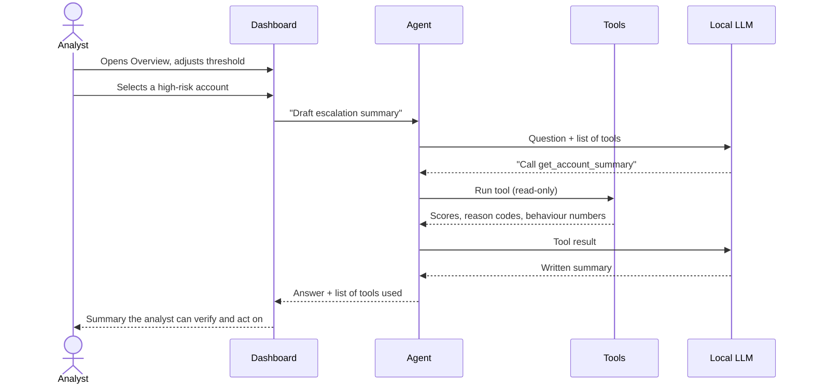
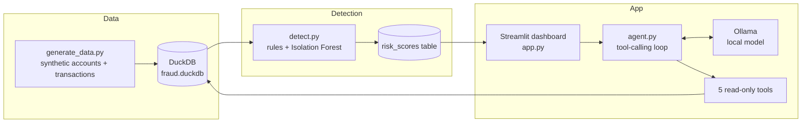

# Fraud Analyst Copilot

An AI assistant that helps fraud analysts at a trading platform find suspicious accounts, understand *why* they were flagged, and draft escalation cases, running fully locally and for free.

> Built as a prototype for an AI challenge (Anti-Fraud track). **All data is synthetic.** Nothing here uses real customer data.

**Demo video:** _add link here_

---

## The problem

Fraud and risk analysts spend hours moving between dashboards and SQL to work out why one account looks suspicious, and then write up the case by hand. Most flagged accounts also turn out to be genuine customers, so time is lost on false alarms.

**Who it's for:** fraud and risk analysts, and the team leads who decide how aggressive the alerts should be.

## The solution

1. **Detect:** score every account from 0 to 100 using transparent rules (each with a reason code) plus an Isolation Forest anomaly score.
2. **Review:** a dashboard shows KPIs, trends and risk drivers, with a threshold slider that shows the trade-off between catching fraud and annoying genuine customers.
3. **Explain:** an AI agent answers questions in plain English, explains why an account was flagged, and drafts an escalation summary. It always pulls facts from tools and never decides on its own.

### User flow



## Architecture



| Component | What it does |
|---|---|
| `generate_data.py` | Creates about 3,500 accounts and 420,000 transactions with 4 fraud patterns, 3 disguised variants and 4 look-alike genuine groups |
| `detect.py` | Builds features in SQL, applies weighted rules with reason codes, adds an Isolation Forest score, and assigns a risk tier |
| `app.py` | Streamlit dashboard: KPIs, charts, case review, agent chat |
| `agent.py` | The agent: a language model, five tools and a loop that runs until the model answers |

### The agent's tools

| Tool | Purpose |
|---|---|
| `get_account_summary` | Score, tier, reason codes (with plain-English meanings) and behaviour numbers |
| `get_linked_accounts` | Other accounts sharing a payment method or device |
| `list_high_risk_accounts` | Highest-risk accounts, optionally for one affiliate |
| `get_portfolio_stats` | Totals, top reason codes, riskiest affiliates |
| `run_sql` | Read-only SELECT queries |

### Guardrails

- **Read-only:** the database connection is opened read-only, and `run_sql` accepts only a single SELECT.
- **No answer key:** the hidden fraud labels used for testing are blocked from the agent.
- **Explains, doesn't decide:** the system prompt tells the agent to say an account matches patterns needing review, never that it *is* fraud.
- **Transparent:** every answer shows which tools were called and what they returned, so the analyst can check it.
- **Local:** the model runs on the analyst's machine, so no data leaves it.

## Results (on synthetic data)

| Setting | Flagged | Precision | Recall |
|---|---|---|---|
| Review threshold (score 20 and above) | 439 of 3,457 | 64.5% | 100% |
| High-risk tier only (score 40 and above) | 367 | 59% | 77% |

Precision and recall are measured against patterns we planted, so real-world performance would be lower. The point of the prototype is the **trade-off**: lowering the threshold catches more fraud but sends more genuine customers to review, and the dashboard lets an analyst pick the balance.

## Run it yourself (Windows)

1. Install Python 3.11 or newer (tick "Add python.exe to PATH") and [Ollama](https://ollama.com/download).
2. Download a model: `ollama pull qwen2.5:7b` (use `qwen2.5:3b` on 8 GB of RAM, and run `set OLLAMA_MODEL=qwen2.5:3b` first).
3. In the project folder:

```
python -m venv venv
venv\Scripts\activate
pip install -r requirements.txt
python generate_data.py
python detect.py
streamlit run app.py
```

Open the **Ask the agent** tab. You can also test the agent alone:
`python agent.py "Why is account A03211 flagged?"`

## Limitations and next steps

- **Synthetic data:** rules and data were written by the same person, so scores are optimistic. Next step: test on real, labelled data.
- **Small local model:** it sometimes misreads a rule's meaning. Mitigations so far: plain-English reason codes and unambiguous tool output. Next step: evaluate larger models and add automated answer checks.
- **Human in the loop:** the agent never blocks accounts or makes final decisions.
- **Fairness and compliance:** real use would need bias testing (for example, by country or affiliate), audit logging and a privacy review.
- **Next features:** feedback buttons so analysts can mark false alarms, retraining from that feedback, and alert delivery through a workflow tool such as n8n.

## Project structure

```
fraud-copilot/
├── generate_data.py   # synthetic data
├── detect.py          # risk scoring
├── agent.py           # agent: tools + loop
├── app.py             # Streamlit dashboard
├── check_setup.py     # install check
├── requirements.txt
└── README.md
```

## Author

Deepika Ravikumar, Data analyst.https://www.linkedin.com/in/deepikaravikumar250989
